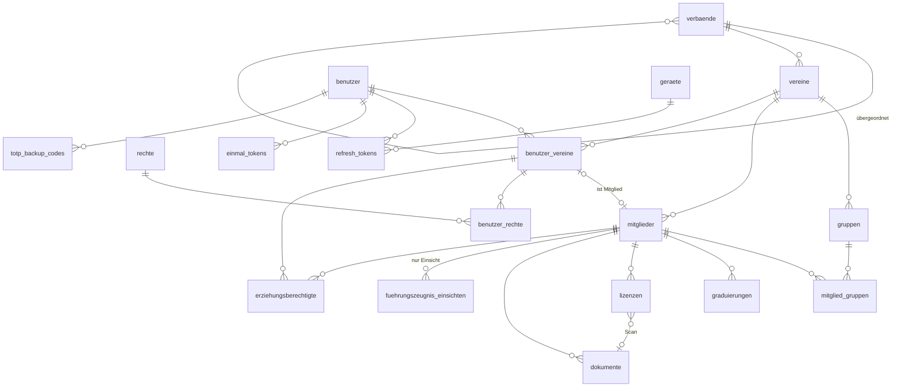

# Stammdaten-Server – Datenbankentwurf

Zentraler Node.js-Dienst für **Vereine, Mitglieder, Benutzer und Rollen**. Er stellt die Daten per REST für
Dojo-Master-Pro, Hajime-Pro und Kyu-Manager-Pro bereit und ist zugleich der **Anmeldedienst** für alle drei Apps.

Das vollständige, lauffähige Schema steht in [`db/schema.sql`](../db/schema.sql). Es setzt PostgreSQL 15 oder neuer voraus und ist auf PostgreSQL 18 getestet.
Lokal ohne Installation: `npm install` und `npm run db:test`. Das startet ein eingebettetes PostgreSQL 18
(embedded-postgres), spielt das Schema in eine frische Datenbank ein, prüft die wichtigsten Regeln und räumt danach
auf. Mit `npm run db:test -- --behalten` läuft der Server weiter (Port 54329).

---

## 1. Grundlage: was die Apps heute speichern

| Daten | Dojo-Master-Pro | Hajime-Pro | Kyu-Manager-Pro | DJB-Export (xlsx) |
|---|---|---|---|---|
| Mitglied: Name, Geburtsdatum, Geschlecht | `mitglieder` | `turnier_teilnehmer` (Kopie je Turnier) | `members` | ✔ |
| Anschrift, E-Mail, Telefon | ✔ | – | – | ✔ + Nationalität, Land |
| Mitgliedsnr., Eintritt/Austritt, Status | ✔ (+ Kündigung, passiv, Ehrenmitglied, Azubi) | – | `nr` | Anmeldedatum |
| Graduierung | Text `graduierung` + `pruefungen` | Text `graduierung` | `kyu`/`dan` + `graduations` | je Grad **Nr. + Datum** |
| Judopass | `judopass_nr`, `judopass_url` | `judopass_id`, `lizenz_ablauf` | `pass_nr` | Nr. + gültig bis |
| Lizenzen/Nachweise | – | – | Trainer-Flag „graduierungsberechtigt“ | Wettkampf-, Graduierungslizenz, eFZ-Prüfer, Ehrenkodex, Führungszeugnis, Erste Hilfe |
| Gruppen | `gruppen` (+ Trainingszeiten) | – | `groups` + `member_groups` | – |
| Benutzer | `benutzer` (Name, Rolle, `mitglied_id`) | `benutzer` (E-Mail, n:m Vereine, 2FA, Super-Admin) | `users` (+ PIN, Geräte, Refresh-Tokens) | – |
| Rollen | admin, kasse, trainer, kassenprüfer + Zusatz „Prüfer“, zusätzlich Rollen über Vereinsämter | admin, benutzer, helfer je Verein | schüler, trainer, prüfer, admin; Eltern-Zugang | – |
| Verein | genau ein Verein (Gläubiger-ID, Konto, Steuerdaten, Logo) | viele Vereine (auch Gastvereine), Bundesland | `clubs` (mandantenfähig) | Landesverband, Verein |

**Was in den Apps bleibt** (Bewegungs- und Fachdaten): Beitragsklassen, Forderungen, SEPA-Läufe, Bankumsätze,
Buchhaltung (Dojo-Master-Pro) · Turniere, Pools, Kämpfe, Turnier-Teilnehmer als Momentaufnahme (Hajime-Pro) ·
Modulprüfungen, Prüfungsbögen, Favoriten (Kyu-Manager-Pro). Die Apps verweisen dafür nur noch auf die `id` aus dem
Stammdaten-Server.

---

## 2. Datenmodell

### 2.1 Vereine

| Tabelle | Zweck |
|---|---|
| `verbaende` | DJB → Landesverband (NWJV) → Bezirk/Kreis; aus dem DJB-Export übernehmbar |
| `vereine` | Stammdaten jedes Vereins. `ist_mandant = true`: Verein nutzt die Apps und pflegt Mitglieder. `false`: nur Referenz, z. B. Gastverein bei einem Hajime-Turnier. Enthält Gläubiger-ID, Vereinskonto (IBAN verschlüsselt) und Gemeinnützigkeitsangaben, weil sie zum Verein gehören. **Nicht** hier: SMTP-/IMAP-/FinTS-Zugänge, Einzugstermine, Kündigungsfrist. Sie sind Einstellungen von Dojo-Master-Pro. |
| `gruppen`, `mitglied_gruppen` | Trainingsgruppen, n:m zu Mitgliedern (Kyu-Manager-Pro braucht n:m, Dojo-Master-Pro hat heute 1:n) |

### 2.2 Mitglieder

| Tabelle | Zweck |
|---|---|
| `mitglieder` | Eine Zeile je **Vereinsmitgliedschaft**. Enthält Person, Kontakt, Mitgliedschaft (Eintritt – nur von Dojo-Master-Pro gesetzt –, Kündigung, Austritt, Status), Tarif-Merkmale (`ehrenmitglied`, `ausbildung_bis`) und `djb_id` aus dem Export |
| `graduierungen` | Historie aller Grade (`art` kyu/dan + `stufe`, Datum, Urkunden-Nr. wie „KYU-13230“). Der aktuelle Grad wird über die View `mitglied_aktueller_grad` ermittelt, nicht gespeichert, damit es keine zwei Wahrheiten gibt. |
| `lizenzen` | Judopass, Wettkampf-, Graduierungs-, Trainer- und Prüferlizenz, eFZ, Ehrenkodex, Erste Hilfe – jeweils mit Nummer und `gueltig_bis`. Ermöglicht Ablaufwarnungen. View `mitglied_judopass` liefert den aktuellen Pass (Hajime: `judopass_id` + `lizenz_ablauf`). |
| `dokumente` | Passfoto, Scan des Erste-Hilfe-Nachweises. **Keine** Führungszeugnisse. |
| `fuehrungszeugnis_einsichten` | Nur die Einsicht in das erweiterte Führungszeugnis: Datum des Zeugnisses, Datum der Einsicht, ob eine einschlägige Verurteilung vorliegt, Ende der Tätigkeit. `loeschen_ab` = Tätigkeitsende + 3 Monate. Wird nicht per Abgleich verteilt, sondern nur live abgefragt (Scope `mitglieder:efz`). |

> **Warum keine Kopie des Führungszeugnisses?** § 72a Abs. 5 SGB VIII erlaubt Vereinen nur, die Einsicht, das Datum
> des Zeugnisses und das Vorliegen einer einschlägigen Verurteilung zu speichern. Die Daten sind zu löschen, wenn die
> Person die Tätigkeit nicht aufnimmt, sonst spätestens drei Monate nach deren Ende.

Die Graduierung wird als Zahl gespeichert (`art` + `stufe`). Die Farbbezeichnung („5. Kyu – Orange“) erzeugt die API.
Damit entfällt die Text-Umstellung, die Dojo-Master-Pro bei der DJB-2025-Migration brauchte.

### 2.3 Zahler, SEPA-Mandate, IBAN – entfallen

> **Geändert:** Bankkonten und SEPA-Mandate (auch für Mitgliedsbeiträge) liegen künftig zentral im Stammdaten-Server,
> siehe [`entwurf-rollen-rechte-lizenzen.md`](entwurf-rollen-rechte-lizenzen.md) 6.5. Der Beitragseinzug bleibt in Dojo-Master-Pro.

Liegen im Abrechnungs-Tool (Dojo-Master-Pro), nicht hier. Zuordnung über `mitglieder.djb_id`. Ebenfalls nicht gespeichert:
`passiv` (Beitragsart), führender Verein, Notizen/Bemerkung (Migration `004_ohne_zahler.sql`).

### 2.4 Benutzer, Rollen, Rechte und Autorisierung

> **Wird ersetzt:** Der neue Entwurf mit Personen, Rollen als Tabelle, Rechten × Operationen, Lizenzen mit Rechten,
> Verbandsbereichen und Prüfungen steht in [`entwurf-rollen-rechte-lizenzen.md`](entwurf-rollen-rechte-lizenzen.md).
> Dieser Abschnitt beschreibt den bisherigen Stand.

**Rollen** legen fest, *wie weit* jemand im Verein darf. Es gibt genau drei, für alle Apps gleich:

| Rolle | Gilt | Gespeichert in | Bedeutung |
|---|---|---|---|
| **Super-Admin** | global | `benutzer.ist_super_admin` | Betreiber: Vereine freischalten, alle Vereine verwalten (2FA Pflicht) |
| **Admin** | je Verein | `benutzer_vereine.rolle = 'admin'` | Verein vollständig verwalten: Stammdaten, Benutzer, Rechte |
| **Mitglied** | je Verein | `benutzer_vereine.rolle = 'mitglied'` | Eigene Daten und die der eigenen Kinder sehen |

**Rechte** legen fest, *welche Funktion* jemand im Verein ausübt. Ein Benutzer kann beliebig viele haben, für alle Apps gleich:

| Recht | Ersetzt | Bedeutung |
|---|---|---|
| `trainer` | Dojo `trainer`, Kyu `trainer` | Gruppen und Mitglieder betreuen |
| `pruefer` | Dojo Zusatzrolle „Prüfer“, Kyu `pruefer` | Prüfungen abnehmen, Graduierungen eintragen |
| `kassierer` | Dojo `kasse` | Beiträge, Buchhaltung (im Abrechnungs-Tool) |
| `kassenpruefer` | Dojo `kassenpruefer` | Kasse und Buchhaltung nur lesend |

Aus den bisherigen App-Rollen wird: Dojo/Hajime/Kyu `admin` → Rolle **Admin** · Hajime `benutzer` und `helfer`, Kyu `schueler` →
Rolle **Mitglied** · Kyu-Eltern → Rolle **Mitglied** + `erziehungsberechtigte`.

**Helfer** sind im Stammdaten-Server normale Mitglieder. Wer bei welchem Turnier welche Aufgabe übernimmt (Waage,
Listenführung, Kampfrichtertisch), plant Hajime-Pro selbst in seiner Helferverwaltung. Hajime-Pro muss dafür angepasst
werden: Zugriff auf die Helfer-App für jedes Mitglied des Vereins statt über die bisherige Rolle `helfer`.

Tabellen:

- **`benutzer`**: ein Konto für alle Apps. Benutzername und E-Mail sind global eindeutig. Enthält Passwort-Hash,
  PIN-Hash (Tablet-Anmeldung aus Kyu-Manager-Pro), Sperre nach Fehlversuchen, Passwortwechsel-Pflicht, E-Mail-Bestätigung,
  TOTP (2FA aus Hajime-Pro) und `ist_super_admin`.
- **`benutzer_vereine`**: Zugehörigkeit zu einem Verein mit **Rolle** (admin/mitglied), Freigabe-Workflow aus Hajime-Pro
  (angefragt → freigegeben) und optionaler Verknüpfung zum eigenen **Mitglied** (Dojo-Master-Pro `benutzer.mitglied_id`).
- **`rechte`**: feste Liste der Rechte (Seed oben).
- **`benutzer_rechte`**: Recht je Benutzer **und Verein**, optional befristet. Ein Recht setzt eine Vereinszugehörigkeit
  voraus (Fremdschlüssel auf `benutzer_vereine`). `attribute` (jsonb) nimmt Zusatzangaben auf, z. B. beim Trainer
  „graduierungsberechtigt vom 8. bis 4. Kyu“ für Kyu-Manager-Pro.
- View **`benutzer_wirksame_rechte`**: gültige Rechte freigegebener Vereinszugehörigkeiten.
- **Keine Vereinsämter**: Rolle und Rechte werden direkt vergeben. Vorsitz, Kassenwart usw. sind keine Zugriffsinformation;
  falls Dojo-Master-Pro sie weiter anzeigen oder für Postfach-Zugriffe nutzen will, bleiben sie dort als Fachdaten.
- **`erziehungsberechtigte`**: Eltern-Konto sieht mehrere Kinder (Kyu-Manager-Pro).
- **`anwendungen`**: registrierte Apps (OAuth-Clients) mit drei Spalten für die Sichtbarkeit:
  `scopes` ist die **Obergrenze** für Benutzer-Tokens dieser App, `client_scopes` (Teilmenge von `scopes`, per Check
  erzwungen) das, was die App im Server-zu-Server-Abgleich **ohne Benutzer** bekommt, und `lizenz_arten` schränkt die
  ausgelieferten Lizenzarten ein (`null` = alle). Beispiel: Hajime-Pro bekommt nie Anschrift oder Bankdaten und nur
  Judopass und Wettkampflizenz.
- **Anmeldung**: `refresh_tokens` (Rotation, Widerruf, Gerät; `familie_id` = alle Tokens einer Anmeldung, bei Wiederverwendung wird die ganze Familie widerrufen; `art = 'geraet'` = langlebiges Geräte-Token für das Offline-Entsperren am Tablet, siehe API-Entwurf 6.1.3), `einmal_tokens` (E-Mail-Bestätigung, Passwort-Reset,
  Einladung mit vorgesehener Rolle und Rechten), `totp_backup_codes`, `geraete` (Vereins-Tablets),
  `signaturschluessel` (Schlüsselrotation).

**API-Scopes** regeln den Zugriff auf die REST-API des Stammdaten-Servers. Sie werden nicht gespeichert, sondern im
Server-Code aus Rolle und Rechten abgeleitet:

| Scope | Zeilen / Felder | Super-Admin | Admin | Mitglied | trainer | pruefer | kassierer | kassenpruefer |
|---|---|:-:|:-:|:-:|:-:|:-:|:-:|:-:|
| `mitglieder:selbst` | eigene Zeile + Kinder; Felder laut Selbst-Profil der App | ✔ | ✔ | ✔ | ✔ | ✔ | ✔ | ✔ |
| `mitglieder:lesen` | ganzer Verein (aktiv, ruhend); `kern`, `sport` | ✔ | ✔ | | ✔ | ✔ | ✔ | ✔ |
| `mitglieder:person` | `person` | ✔ | ✔ | | ✔ | ✔ | ✔ | ✔ |
| `mitglieder:mitgliedschaft` | `mitgliedschaft` | ✔ | ✔ | | ✔ | | ✔ | ✔ |
| `mitglieder:kontakt` | `kontakt` | ✔ | ✔ | | ✔ | | ✔ | |
| `mitglieder:tarif` | `tarif` | ✔ | ✔ | | | | ✔ | ✔ |
| `mitglieder:verwaltung` | `verwaltung` | ✔ | ✔ | | | | | |
| `mitglieder:ausgetretene` | Zeilen mit Status `ausgetreten` | ✔ | ✔ | | | | ✔ | ✔ |
| `mitglieder:schreiben` | | ✔ | ✔ | | ✔ | | | |
| `graduierungen:lesen` / `:schreiben` | Historie | ✔/✔ | ✔/✔ | | ✔/– | ✔/✔ | | |
| `lizenzen:judopass` | Feldgruppe `judopass` + Lizenzart `judopass` | ✔ | ✔ | | ✔ | ✔ | | |
| `lizenzen:lesen` / `:schreiben` | alle Lizenzarten | ✔/✔ | ✔/✔ | | ✔/– | ✔/– | | |
| `mitglieder:efz` | Führungszeugnis-Einsicht lesen und eintragen | ✔ | ✔ | | | | | |
| `vereine:lesen` | `oeffentlich` | ✔ | ✔ | ✔ | ✔ | ✔ | ✔ | ✔ |
| `vereine:kontakt` / `vereine:finanzen` | | ✔/✔ | ✔/✔ | | ✔/– | ✔/– | ✔/✔ | ✔/✔ |
| `vereine:schreiben` | | ✔ | ✔ | | | | | |
| `gruppen:lesen` / `:schreiben` | | ✔/✔ | ✔/✔ | eigene/– | ✔/✔ | ✔/– | ✔/– | ✔/– |
| `benutzer:verwalten`, `rechte:verwalten` | | ✔ | ✔ | | | | | |
| `benutzer:schueler` | Schüler-Zugänge anlegen / Passwort zurücksetzen (Kinder ohne E-Mail) | ✔ | ✔ | | ✔ | | | |

Welche dieser Scopes eine App höchstens bekommt (App-Obergrenze, `anwendungen.scopes`) und welche Felder zu den
Feldgruppen (`kern`, `sport`, `person`, …) gehören, steht im [API-Entwurf](api-entwurf.md) (Abschnitte 2 und 3).

**Ablauf der Autorisierung**

1. Die App leitet den Benutzer zum Stammdaten-Server (oder ruft `POST /auth/login` auf) und erhält ein kurzlebiges
   **Access-Token** (JWT, EdDSA, ca. 10 Minuten) und ein Refresh-Token.
2. Das Token enthält: `sub` (Benutzer-ID), `aud` (App), `verein_id` (aktiver Verein), `rolle` (admin/mitglied),
   `super_admin`, `rechte` (z. B. `["trainer","pruefer"]`), `scope` (Leerzeichen-getrennt), `mitglied_id` (eigenes Mitglied),
   `mitglied_ids` (eigenes Mitglied + Kinder), `sid` (Sitzung = `refresh_tokens.familie_id`). Genaue Liste: [`api-entwurf.md`](api-entwurf.md) 6.1.2.
3. Die Apps prüfen das Token **lokal** über den JWKS-Endpunkt (`/.well-known/jwks.json`), ohne Rückfrage beim Server.
   Ihre Fachlogik („darf Lastschriftlauf starten“) leiten sie aus `rolle` und `rechte` ab.
4. Der Stammdaten-Server prüft bei jedem eigenen REST-Aufruf die Scopes: wirksam sind die Benutzer-Scopes ∩ die
   App-Obergrenze (`anwendungen.scopes`). Daraus ergeben sich Zeilenfilter und Feldgruppen; nicht erlaubte Felder fehlen
   im JSON. Ohne `mitglieder:kontakt` fehlen zum Beispiel Anschrift und E-Mail. Details in [`api-entwurf.md`](api-entwurf.md).
5. Sperren und Änderungen an Rolle oder Rechten wirken spätestens beim nächsten Refresh, also nach höchstens rund
   10 Minuten. Falls das sofort wirken muss, gibt es zusätzlich `GET /ich`.

### 2.5 Abgleich, Protokoll, Datenschutz

- **Sync-Spalten** auf allen Stammdatentabellen, auch auf `mitglied_gruppen` und `erziehungsberechtigte`:
  `geaendert_am`, `geloescht_am` (Soft Delete), `change_seq` und `change_xid` (beide per Trigger).
  Verknüpfungen werden also nicht gelöscht, sondern mit `geloescht_am` markiert, damit Apps das Austragen mitbekommen.
- **Abgleich-Cursor `change_xid`**: Apps holen Änderungen mit `GET /mitglieder?seit=<stand>` und bekommen einen neuen
  `stand` zurück. Der Server liefert nur Zeilen aus Transaktionen, die sicher abgeschlossen sind
  (`change_xid < pg_snapshot_xmin(pg_current_snapshot())`). Eine reine laufende Nummer reicht nicht: ein langsamer
  Schreibvorgang mit kleinerer Nummer kann später sichtbar werden als ein schneller mit größerer und würde übersprungen.
  Zeilen können doppelt kommen, nie aber fehlen; Apps übernehmen sie per Upsert. Die Abfrage steht in `schema.sql`,
  Abschnitt 8.
- **`change_seq`** dient als Versionsnummer der Zeile: Die App schickt sie beim Speichern als `If-Match` mit; hat sich
  die Zeile inzwischen geändert, lehnt der Server mit 412 ab.
- **Vereinsgrenzen in der Datenbank**: Verweise zwischen vereinsbezogenen Tabellen laufen über `(verein_id, id)`.
  Ein Mitglied kann so nicht auf eine Gruppe oder Graduierung eines anderen Vereins zeigen, auch wenn
  der Code einen Fehler hat. Ein Eltern-Zugang setzt eine Vereinszugehörigkeit des Eltern-Kontos im Verein des Kindes
  voraus.
- Optional **`webhook_abos`**: Push bei Änderungen (signiert per HMAC).
- **`audit_log`**: jede Änderung mit alt/neu .
- Verschlüsselt: IBAN des Vereinskontos, TOTP-Geheimnisse, private Signaturschlüssel. Gehasht: Passwörter, PINs,
  alle Tokens.
- **Löschfristen (DSGVO)**: Die Funktion `datenschutz_bereinigen()` läuft täglich. Sie leert Personendaten nach Ablauf
  der Fristen in `aufbewahrungsfristen` und setzt `anonymisiert_am`. Die leere Zeile bleibt als Löschhinweis für den
  Abgleich; Apps entfernen den Datensatz dann auch lokal.

  | Was | Frist (Vorschlag) | Ab |
  |---|---|---|
  | Ausgetretene Mitglieder samt Graduierungen, Lizenzen, Dokumenten, Gruppen, Eltern-Zugängen | 3 Jahre | Austritt |
  | Gelöschte Mitglieder, Benutzer (Papierkorb) | 30 Tage | Löschung |
  | Führungszeugnis-Einsicht (wird gelöscht, nicht anonymisiert) | 3 Monate | Ende der Tätigkeit |
  | Protokoll (`audit_log`) | 2 Jahre | Eintrag |
  | Abgelaufene oder widerrufene Tokens | 30 Tage | Ablauf |

  Die Fristen sind Vorschläge und sollten mit Datenschutzbeauftragten bzw. Steuerberater abgestimmt werden. Sie lassen
  sich in der Tabelle ändern, ohne das Schema anzupassen.

---

## 3. Abbildung auf die Apps

| App braucht | liefert der Stammdaten-Server |
|---|---|
| **Hajime-Pro** Meldung: `judopass_id`, Vor-/Nachname, Geburtsdatum, Geschlecht, Verein, Graduierung, `lizenz_ablauf` | `mitglieder` + `mitglied_judopass` + `mitglied_aktueller_grad` + `vereine` (Scopes `mitglieder:lesen` + `mitglieder:person` + `lizenzen:judopass`, ohne Kontaktdaten). Gewicht und Startgeld bleiben im Turnier. |
| **Hajime-Pro** Benutzer, Vereine, Freigaben, Rollen admin/benutzer/helfer, Super-Admin, 2FA | `benutzer`, `benutzer_vereine` (Rolle; Helfer = Mitglied, Einsatzplanung bleibt in Hajime-Pro), `totp_*` |
| **Kyu-Manager-Pro** `members` (nr, Name, Geburtsdatum, pass_nr, kyu, dan), `groups`, `graduations`, `users`, `user_roles`, `devices`, `refresh_tokens` | entsprechende Tabellen; `user_roles` wird zu Rolle + Rechten. Neue Graduierungen schreibt Kyu-Manager-Pro mit `quelle = 'kyu-manager-pro'` zurück. |
| **Dojo-Master-Pro** `mitglieder`, `familien`, `gruppen`, `benutzer`, `aemter`, `verein`-Stammteil | `mitglieder`, `gruppen`, `benutzer` (Rolle + Rechte statt Ämter-Rollen). `forderungen`, `antraege`, `spenden` usw. verweisen künftig auf `mitglied_id` (uuid); Zahler und Mandate bleiben in Dojo-Master-Pro. |

**Import aus dem DJB-Export (CSV/xlsx)**: Personen- und Kontaktfelder → `mitglieder` · „n. Kyu/Dan … Nr./Datum“ → `graduierungen` ·
Judopass, Lizenzen, eFZ-Prüfer, Ehrenkodex, Graduierungslizenz → `lizenzen`. **Nicht übernommen**: Kontoinhaber, IBAN, Abbuchungsintervall,
Beitragsart, Anmelde-Datum (das setzt nur Dojo-Master-Pro), Bemerkung, führender Verein, Erste-Hilfe, Scans (Abrechnungs-Tool; Schlüssel ist `djb_id`).

---

## 4. Offene Entscheidungen

1. **Kinder-Logins** (entschieden für Kyu-Manager-Pro): Benutzernamen sind global eindeutig (für Single Sign-on nötig). Jedes Kind hat
   einen eigenen Zugang ohne E-Mail, den der Trainer anlegt (Startpasswort + Wechselpflicht, `benutzer:schueler`) und bei Bedarf
   zurücksetzt. Kyu-Manager-Pro hat die Namen bisher je Verein eindeutig – bei der Übernahme ggf. mit Vereinskürzel versehen.
2. **Person vereinsübergreifend**: Eine Zeile je Mitgliedschaft (einfach, passt zu allen Apps). Eine Person mit
   Zweitverein steht dann zweimal in der Datenbank und wird über die Judopass-Nummer verknüpft. Alternative: eigene Tabelle
   `personen` mit n Mitgliedschaften (sauberer, aber mehr Aufwand in jeder App).
3. **Beitragsklassen**: bleiben in Dojo-Master-Pro. Der Stammdaten-Server liefert nur die Merkmale (Alter,
   Ehrenmitglied, Ausbildung).
4. **Migrationswerkzeug**: Knex (wie Dojo-Master-Pro/Hajime-Pro) oder node-pg-migrate (wie Kyu-Manager-Pro).
   Das Schema ist bewusst als reines SQL geschrieben und passt zu beiden.
